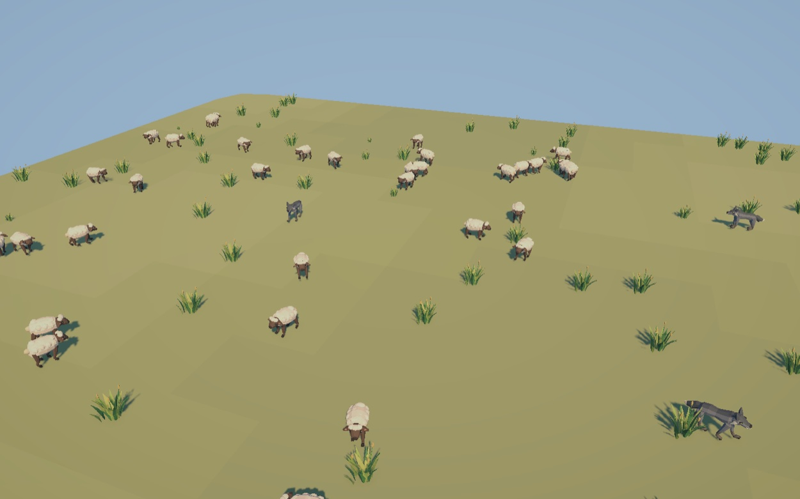
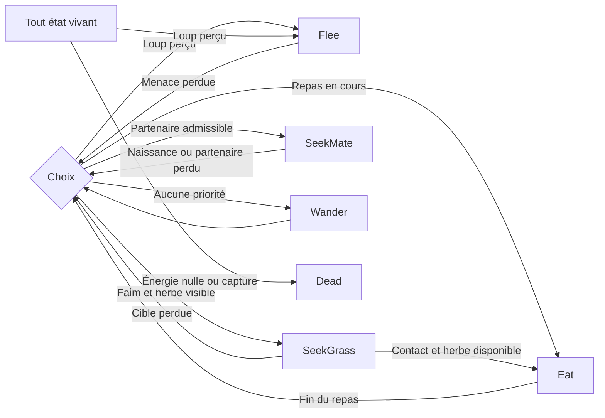
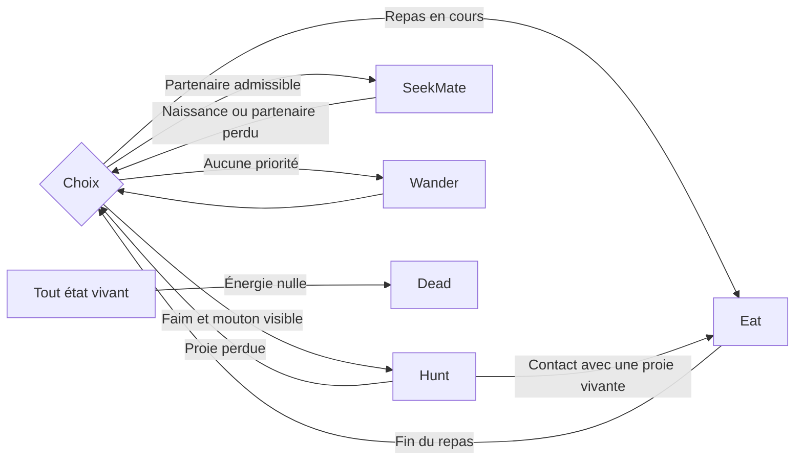
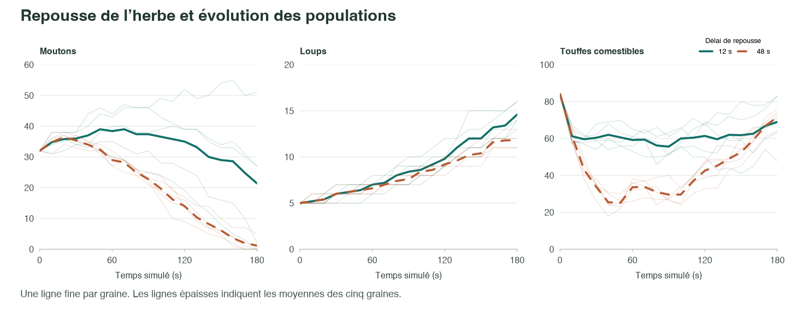

# Loups, moutons et herbe

Simulation multi-agents réalisée dans Unity pour le workshop d’informatique. Le pré démarre avec **32 moutons, 5 loups et 84 touffes d’herbe**. Chaque animal agit selon son énergie et ce qu’il perçoit. La population peut croître, coexister ou s’éteindre.

## Lancer la scène

1. Dans Unity Hub, ajouter le dossier qui contient `Assets`, `Packages` et `ProjectSettings`. Utiliser **Unity 6000.6.4f1**.
2. Ouvrir `Assets/Scenes/SampleScene.unity` et appuyer sur **Play**.
3. **F2** affiche les courbes. Les touches **1, 2, 3 et 4** règlent la vitesse sur ×1, ×2, ×4 et ×8. Cliquer dans la vue Game pour piloter la caméra avec les flèches et la souris. **Échap** libère le pointeur et **F1** affiche l’aide.

Pour modifier une expérience, arrêter Play, sélectionner **Simulation → Ecosystem Simulation → Settings** et changer les paramètres dans l’Inspector. `seed` fixe le tirage initial, `regrowthSeconds` règle le délai de repousse. Les rubriques `sheep` et `wolves` donnent accès à la vitesse, à la vision, au métabolisme et aux conditions de reproduction.

## Ce qui se passe sur le terrain

| Règle | Mouton | Loup |
|---|---|---|
| Perception | Dans un rayon de 8 m, mémorise le loup, la touffe disponible et le partenaire les plus proches. | Dans un rayon de 12 m, mémorise le mouton et le partenaire les plus proches. |
| Faim | À 68 d’énergie ou moins, cherche une touffe et récupère 27 au contact. | À 62 ou moins, chasse et récupère 46 en attrapant un mouton. |
| Danger et repas | Un loup détecté interrompt le déplacement vers l’herbe, le repas ou la recherche de partenaire. | Après une capture, le loup mange sur place pendant 2,4 s. |
| Reproduction | À partir de 16 s et 78 d’énergie, chacun des deux parents dépense 23. Délai entre naissances de 22 s. | À partir de 24 s et 81 d’énergie, chacun dépense 28. Délai de 32 s. |
| Mort | À zéro d’énergie ou au contact d’un loup en chasse. | À zéro d’énergie. |

Les deux partenaires doivent s’être choisis et se toucher pour donner naissance à un seul petit. Les animaux de départ sont adultes. Les nouveau-nés doivent atteindre la maturité. L’énergie est plafonnée à 100. Au broutage, la touffe redevient une petite pousse. Sa taille suit sa repousse, et son collider se réactive quand elle est à nouveau comestible.

## Modèles et animations

Le mouton, le loup, la touffe et le terrain ont été modélisés pour ce projet. Les animaux ont chacun un maillage et un squelette. Le mouton a une toison festonnée et des sabots fendus. Le loup a un museau effilé, des pattes articulées et une queue bicolore.

| Modèle | Animation dans Unity | Source Blender |
|---|---|---|
| Mouton | Marche, course bondissante pour fuir et broutage avec mouvement de la tête et de la mâchoire. | [Sheep.blend](ArtSource/Sheep.blend) |
| Loup | Marche, galop de chasse et repas. La queue et les oreilles accompagnent le mouvement. | [Wolf.blend](ArtSource/Wolf.blend) |
| Herbe | Oscillation au vent et déploiement des brins. Le temps du clip de repousse est piloté par la disponibilité de la nourriture. | [Grass.blend](ArtSource/Grass.blend) |
| Terrain | Maillage statique avec variations de couleur, bords arrondis et couches de terre. | [MeadowGround.blend](ArtSource/MeadowGround.blend) |

Dans Blender, sélectionner le squelette et ouvrir le **NLA Editor** pour modifier les actions. Pour les animaux, les trois séquences commencent aux images 1, 40 et 70. Les FBX importés dans Unity se trouvent dans `Assets/Models/MeadowArt`. Le [script de génération](ArtSource/build_models.py) permet de reconstruire les quatre sources avec Blender 5.x.

## Machines à états

L’état est réévalué à chaque pas de 0,05 s. La perception est rafraîchie toutes les 0,4 à 0,6 s. Dans les graphes, **Choix** représente la décision suivante. Une cible perdue, déjà mangée ou devenue inéligible déclenche un nouveau choix.

**Mouton**

**Loup**

**Exemple à suivre dans l’Inspector.** Sélectionner un mouton sous `Simulation/Sheep` en mode Play. Le composant `Organism View` affiche son état, son énergie et sa cible. Si un loup entre dans son rayon alors qu’il se dirige vers l’herbe, le prochain scan fait passer le mouton de `SeekGrass` à `Flee`. Sa cible devient le loup et sa direction de déplacement s’en éloigne. Quand la menace sort du rayon, il peut reprendre sa recherche de nourriture.

## Organisation du projet

| Élément | Rôle |
|---|---|
| `Assets/Scenes/SampleScene.unity` | Terrain de 64 m de côté par défaut, lumière, caméra et objet Simulation. La taille du sol suit le paramètre `halfExtent`. La caméra porte les contrôles et le graphique fournis avec le projet de départ. |
| `Assets/Prefabs` et `Assets/Animations` | Chaque prefab associe un collider sphérique en mode trigger et un enfant graphique. Les animaux possèdent un Animator pour la marche, la course et le repas. |
| `EcosystemSimulation.cs` | Crée le pré au lancement, avance l’horloge à pas fixe et relève les trois effectifs chaque seconde. |
| `MeadowScene.cs` | Instancie les prefabs, synchronise leurs positions, sonde les couches `Animals` et `Food` avec `OverlapSphereNonAlloc` et vérifie les contacts avec `ComputePenetration`. |
| `Model/Animal.cs` | Choisit la cible et l’état, tourne vers sa destination et applique les règles d’énergie et de maturité. |
| `Model/Meadow.cs` | Fait repousser l’herbe et résout les rencontres. Les captures sont traitées avant le broutage et les naissances. Deux loups au même endroit ne peuvent pas manger deux fois le même mouton. |
| `Model/MeadowSettings.cs` et `Model/Organism.cs` | Paramètres, espèces, états et disponibilité des touffes. |
| `Assets/Editor/PopulationStudy.cs` | Lance les expériences sur les mêmes prefabs, les mêmes règles et le même moteur physique que le mode Play. |

## Expérience sur la repousse

**Question.** Comment le passage de 12 à 48 secondes de repousse modifie-t-il les populations ? Les mêmes cinq graines (17, 29, 43, 61 et 79) sont jouées avec les deux délais. Chaque partie dure 180 secondes simulées. Le programme relève les effectifs toutes les 10 secondes, ainsi que les cumuls de captures, de broutages, de repousses, de naissances et de morts de faim.

**Rejouer l’expérience.** Dans Unity, hors mode Play, choisir **Ecosystem → Run grass regrowth study** et sélectionner le fichier CSV de destination. Les réglages du protocole sont définis dans `PopulationStudy.cs`. Chaque paire utilise les paramètres d’origine du modèle et partage ses positions initiales.

| Résultat à 180 s, sur cinq parties | Repousse en 12 s | Repousse en 48 s |
|---|---:|---:|
| Moutons vivants, moyenne | 21,4 | 1,2 |
| Parties avec au moins un mouton | 4 sur 5 | 2 sur 5 |
| Naissances de moutons, moyenne cumulée | 49 | 16 |
| Loups vivants, moyenne | 14,6 | 11,8 |

Avec la repousse lente, les moutons se sont moins reproduits dans les cinq paires. La graine 61 illustre la variabilité du résultat final. Elle termine avec 2 moutons en repousse rapide et 5 en repousse lente. Ces dix parties décrivent le comportement du modèle sur trois minutes.

Le [CSV des 190 relevés](Experiments/regrowth.csv) permet de retrouver chaque trajectoire.

## Hypothèses et limites

Le terrain est plat, la vision porte dans toutes les directions et les animaux peuvent se croiser. Une seule touffe nourrit un mouton par cycle de repousse. Les agents meurent de faim ou de prédation et n’ont aucune limite d’âge. Les effectifs observés dépendent de ces choix et de la durée de chaque partie.

## Crédits

La scène initiale, la caméra libre, les commandes de vitesse et la base du graphique des populations viennent du dépôt du cours. Les quatre maillages et les huit clips de ce projet sont fournis avec leurs sources Blender. [Projet de départ de Paul Ecoffet](https://github.com/PaulEcoffet/createch_compsci_3_prey_predator_base)
