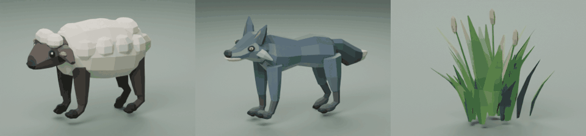
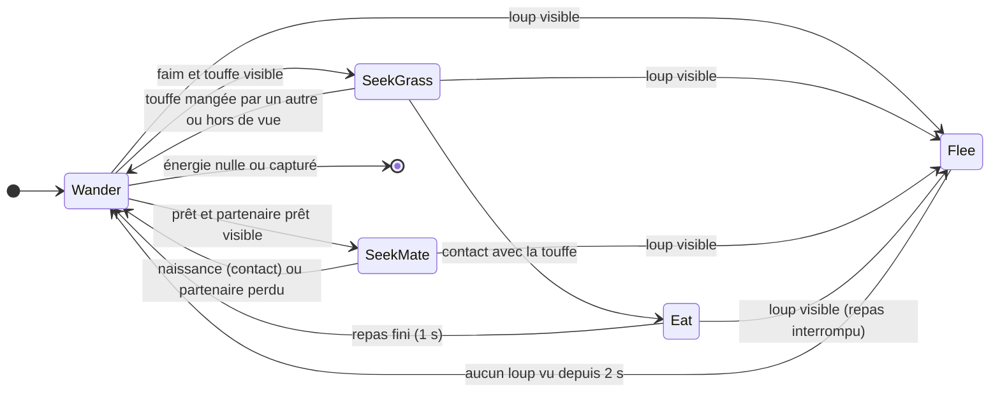
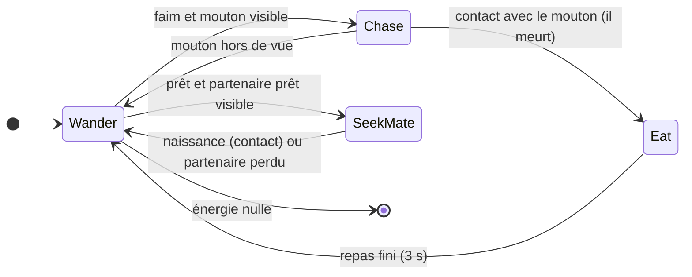
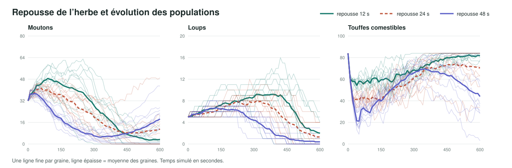

# Loups, moutons et herbe — simulation proie-prédateur dans Unity

Simulation multi-agents réalisée pour le workshop CompSci WS3. Le pré démarre avec **32 moutons, 5 loups et 84 touffes d'herbe**. Chaque animal est un GameObject autonome : il perçoit son voisinage, choisit un état avec sa propre machine à états, se déplace, mange, se reproduit et meurt. Aucun script central ne décide à sa place. L'objet `Simulation` se contente de créer le pré, de connaître ses limites et de compter les populations.



## 1. Lancer la simulation

1. Dans Unity Hub, **Add → Add project from disk**, puis choisir le dossier qui contient `Assets`, `Packages` et `ProjectSettings`. Version : **Unity 6000.6.4f1**.
2. Ouvrir `Assets/Scenes/SampleScene.unity` et appuyer sur **Play**.
3. Commandes en mode Play :

| Touche | Effet |
|---|---|
| Clic dans la vue Game | Piloter la caméra (souris pour regarder, ZQSD ou flèches pour se déplacer, Espace / Ctrl pour monter / descendre, Maj pour accélérer). Échap libère la souris. |
| **F1** | Aide de la caméra |
| **F2** | Courbes des populations (moutons, loups, touffes comestibles) |
| **1, 2, 3, 4** | Vitesse ×1, ×2, ×4, ×8 |


**Observer un agent.** En mode Play, déplier `Simulation → Sheep` (ou `Wolves`) dans la Hiérarchie et sélectionner un animal. L'Inspector affiche en direct son **Energy** et son **State**, et la vue Scene dessine son rayon de vision (gizmo jaune). L'objet `Simulation` affiche les **Live statistics** : effectifs, naissances, captures, morts de faim, broutages.

## 2. Ce qui est simulé

| | Mouton | Loup | Herbe |
|---|---|---|---|
| **Explorer** | Marche dans une direction aléatoire qui change toutes les 5 à 9 s. | Idem. | — |
| **Percevoir** | Toutes les 0,2 s, dans un rayon de 9 m : le loup, la touffe comestible et le partenaire les plus proches. | Toutes les 0,2 s, dans un rayon de 8 m : le mouton et le partenaire les plus proches. | — |
| **Manger** | Affamé (énergie ≤ 68) et une touffe visible : il y va. Au contact, il broute pendant 1 s et gagne 27. | Affamé (énergie ≤ 62) et un mouton visible : il le chasse en courant. Au contact, le mouton meurt et le loup mange pendant 3 s (+46). | Une touffe broutée rapetisse et disparaît de la perception des moutons. Elle redevient comestible après 12 s. |
| **Fuir** | Un loup visible interrompt tout (même le repas). Le mouton court à l'opposé du loup et continue 2 s après l'avoir perdu de vue. | — | — |
| **Se reproduire** | Adulte (16 s), énergie ≥ 78, hors délai de 22 s : il rejoint un partenaire prêt. Au contact, un agneau naît et chaque parent paie 23. | Adulte (24 s), énergie ≥ 81, délai de 32 s, coût de 35 par parent. | — |
| **Mourir** | Énergie à zéro (−1,05 par seconde) ou attrapé par un loup. | Énergie à zéro (−1 par seconde). | — |

L'énergie est plafonnée à 100. Les animaux du départ sont adultes, avec une énergie tirée entre 55 et 90. Un nouveau-né a 36 d'énergie, mesure 60 % de la taille adulte et grandit jusqu'à sa maturité. Les animaux restent dans le pré : près d'un bord, leur direction est déviée vers l'intérieur.

## 3. Organisation du projet Unity

### Scène `SampleScene`

```
SampleScene
├── Main Camera          FreeCamera, FreeCameraHUD, PopulationPlot (scripts fournis)
├── Directional Light
├── Terrain              sol (redimensionné par Simulation) + BoxCollider
└── Simulation           Simulation, SimulationSpeed (fourni), PopulationExperiment (désactivé, voir section 6)
    ├── Grass            créé au Play : 84 touffes
    ├── Sheep            créé au Play : les moutons
    └── Wolves           créé au Play : les loups
```

### Prefabs (`Assets/Prefabs`)

Chaque prefab sépare la **logique** (l'objet racine) de l'**affichage** (l'enfant `Graphics`), comme vu en cours. On peut changer de modèle 3D sans toucher au code.

| Prefab | Racine (logique) | Enfant `Graphics` (affichage) |
|---|---|---|
| `Sheep` | Layer `Animals`, `SphereCollider` en trigger, `Rigidbody` cinématique, `SheepBehaviour` | Modèle `Sheep.fbx` + `Animator` (Walk, Run, Eat) |
| `Wolf` | Layer `Animals`, `SphereCollider` en trigger, `Rigidbody` cinématique, `WolfBehaviour` | Modèle `Wolf.fbx` + `Animator` (Walk, Run, Eat) |
| `Grass` | Layer `Food`, `SphereCollider` en trigger, `GrassBehaviour` | Modèle `Grass.fbx` + `Animator` (balancement au vent) |

Le `Rigidbody` cinématique est indispensable : Unity n'envoie les messages `OnTriggerStay` que si l'un des deux colliders en contact a un Rigidbody. Il est cinématique car les animaux sont déplacés par leur script, pas par la gravité.

### Scripts (`Assets/Scripts`)

| Script | Rôle |
|---|---|
| `Agents/AnimalBehaviour.cs` | Classe abstraite commune aux deux espèces : énergie, perception (`Physics.OverlapSphereNonAlloc`), déplacements, repas, reproduction, mort, animations. |
| `Agents/SheepBehaviour.cs` | Machine à états du mouton (`SheepState`) et contacts avec l'herbe et les autres moutons. |
| `Agents/WolfBehaviour.cs` | Machine à états du loup (`WolfState`) et contacts avec les moutons et les autres loups. |
| `Agents/GrassBehaviour.cs` | Touffe d'herbe : comestible ou en repousse. |
| `Simulation/Simulation.cs` | Crée le pré au lancement, fournit les limites du terrain, fait naître les petits, compte les populations et alimente le graphique. |
| `Simulation/PopulationExperiment.cs` | Extension : enchaîne des simulations accélérées et enregistre les populations dans un CSV. |
| `Simulation/SimulationSpeed.cs`, `Presentation/…` | Scripts fournis avec le projet de départ (vitesse, caméra libre, graphique des populations). |

Les autres dossiers : `Animations` (Animator Controllers), `Materials`, `Models/MeadowArt` (FBX), `Prefabs`, `Scenes`, `Settings` (URP). Hors de `Assets` : `ArtSource` (sources Blender et aperçus) et `Experiments` (données et graphique de l'extension).

## 4. Machines à états

Chaque animal exécute la même boucle dans `AnimalBehaviour.Update()` :

1. **Énergie** : elle baisse avec le temps. À zéro, l'animal meurt.
2. **Perception** : toutes les 0,2 s, `Physics.OverlapSphereNonAlloc` liste les colliders des layers `Animals` et `Food` dans le rayon de vision. L'animal garde la cible la plus proche de chaque catégorie.
3. **Machine à états** : `PickState()` choisit l'état, puis un `switch` exécute l'action de cet état.

`PickState()` contient les transitions sous forme d'une liste de règles testées dans l'ordre. **La première règle vraie gagne, donc l'ordre des `if` est la priorité.** Les contacts physiques (`OnTriggerStay`) déclenchent les transitions qui dépendent d'une rencontre : début du repas, capture, naissance.

### Mouton (`SheepBehaviour`)



| Priorité | Règle dans `PickState()` | État |
|---|---|---|
| 1 | Un loup a été vu il y a moins de `fearDuration` (2 s) | `Flee` |
| 2 | Un repas est en cours | `Eat` |
| 3 | Affamé et une touffe comestible est visible | `SeekGrass` |
| 4 | Prêt à se reproduire et un partenaire prêt est visible | `SeekMate` |
| 5 | Sinon | `Wander` |

### Loup (`WolfBehaviour`)



| Priorité | Règle dans `PickState()` | État |
|---|---|---|
| 1 | Un repas est en cours | `Eat` |
| 2 | Affamé et un mouton est visible | `Chase` |
| 3 | Prêt à se reproduire et un partenaire prêt est visible | `SeekMate` |
| 4 | Sinon | `Wander` |

Dans les deux graphes, une flèche vers `Wander` signifie « retour au choix par défaut ». Les règles sont réévaluées à chaque frame : si une règle plus prioritaire est vraie, l'animal y passe directement. Par exemple, un mouton encore affamé après un repas repart vers une autre touffe sans s'arrêter dans `Wander`. La mort peut survenir depuis n'importe quel état : l'animal est retiré de la simulation avec `Destroy`.

### Exemple : tracer une transition

Un mouton broute (`Eat`) quand un loup entre dans son rayon de 9 m.

1. Au scan suivant (≤ 0,2 s), `SheepBehaviour.Notice()` range le loup dans `nearestWolf`.
2. Dans `UpdateStateMachine()`, la position du loup est mémorisée dans `lastWolfPosition` et l'heure dans `lastWolfSeenTime`.
3. `PickState()` teste la règle 1 en premier : `IsScared` est vrai, l'état devient `Flee`, avant même la règle « repas en cours ».
4. L'action `Flee` appelle `StopMeal()` (le repas est abandonné), puis `Move()` dans la direction opposée au loup, à la vitesse de course, avec l'animation `Run`.
5. Deux secondes après la dernière fois où il a vu le loup, `IsScared` redevient faux et le mouton reprend la règle suivante qui s'applique.

## 5. Paramètres réglables dans l'Inspector

Tous les paramètres ont une infobulle dans l'Inspector.

- **`Simulation`** (objet de la scène) : effectifs de départ, `seed` (même graine = mêmes positions de départ, 0 = aléatoire), taille du pré (`halfSize`), marge des bords, intervalle du graphique.
- **Prefabs `Sheep` et `Wolf`** (`SheepBehaviour`, `WolfBehaviour`) : vitesses, vitesse de rotation, intervalle d'exploration, rayon et fréquence de perception, énergie (départ, perte par seconde, gain par repas, seuil de faim, durée du repas), reproduction (seuil, coût, délai, maturité, énergie et taille du nouveau-né). Le mouton a en plus `fearDuration`.
- **Prefab `Grass`** (`GrassBehaviour`) : délai de repousse et taille d'une touffe broutée.

Les deux espèces partagent les mêmes champs, hérités d'`AnimalBehaviour`. Seules les valeurs diffèrent d'un prefab à l'autre.

## 6. Extension : effet de la repousse de l'herbe

**Question.** L'herbe est la ressource des moutons. Comment la vitesse de sa repousse se répercute-t-elle sur les moutons, puis sur les loups ?

**Protocole.** Le composant `PopulationExperiment` enchaîne 30 parties : 10 graines (17, 29, 43, 61, 79, 97, 113, 131, 151 et 173) × 3 délais de repousse (12, 24 et 48 s). Pour une graine donnée, l'état de départ est identique : seul le délai change. Chaque partie dure 600 s simulées. Toutes les 10 s, le composant relève les effectifs, les touffes comestibles et les cumuls (naissances, captures, broutages, morts de faim). Chaque frame avance d'exactement 0,02 s de temps simulé (`Time.captureDeltaTime`) : le pas de temps ne dépend pas de la vitesse de l'ordinateur. Deux exécutions peuvent en revanche diverger au bout de quelques minutes (voir Limites). L'expérience a donc été lancée deux fois avec les mêmes graines, pour distinguer ce qui se reproduit de ce qui relève du hasard. La caméra est coupée pendant l'expérience pour aller plus vite.

**Rejouer l'expérience.**

1. Sélectionner l'objet `Simulation`, cocher le composant `Population Experiment`, puis appuyer sur Play. La Console affiche l'avancement. Unity quitte le mode Play à la fin et écrit [`Experiments/regrowth.csv`](Experiments/regrowth.csv). Les 30 parties représentent 5 h de temps simulé. Sur notre machine, elles ont pris environ 3 min 30 en mode batch, sans rendu. Dans l'éditeur, compter davantage. Pour aller plus vite, réduire `seeds` ou `durationSeconds`, ou augmenter `timeStep` dans l'Inspector.
2. Lancer `python3 Experiments/plot_regrowth.py`. Le script n'utilise que la bibliothèque standard : il redessine `Experiments/populations.svg` et affiche le tableau de synthèse. Pour la seconde exécution : `python3 Experiments/plot_regrowth.py Experiments/regrowth_replicate.csv replicate.svg`.
3. Décocher `Population Experiment` pour retrouver la simulation normale.



**Résultats à 600 s.** Chaque case donne la première exécution ([`regrowth.csv`](Experiments/regrowth.csv), tracée ci-dessus), puis la seconde ([`regrowth_replicate.csv`](Experiments/regrowth_replicate.csv)). Les trois dernières lignes comptent des parties sur 10. Une population est considérée comme disparue s'il reste 0 ou 1 individu, puisqu'il ne peut plus se reproduire.

| | Repousse 12 s | Repousse 24 s | Repousse 48 s |
|---|---:|---:|---:|
| Broutages, cumul moyen | 738 / 774 | 621 / 588 | 407 / 414 |
| Naissances de moutons, cumul moyen | 90 / 96 | 70 / 67 | 45 / 46 |
| Moutons capturés, cumul moyen | 91 / 93 | 72 / 70 | 45 / 46 |
| Pic de loups, moyenne des maxima | 11,8 / 12,1 | 9,4 / 9,2 | 7,3 / 7,3 |
| Moment du pic de loups, médiane | 375 s / 345 s | 290 s / 265 s | 160 s / 160 s |
| Moutons vivants, moyenne | 3,3 / 6,2 | 11,0 / 8,8 | 18,5 / 17,9 |
| Loups disparus | 5 / 5 | 7 / 9 | 9 / 8 |
| Moutons disparus | 5 / 6 | 5 / 7 | 2 / 2 |
| Les deux espèces présentes | 4 / 4 | 3 / 1 | 1 / 2 |

**Observations.**

1. **Effet direct sur les moutons, reproductible.** Quand l'herbe repousse quatre fois moins vite (48 s au lieu de 12 s), les moutons broutent presque deux fois moins (≈ 410 broutages contre 740 à 770) et naissent deux fois moins (≈ 45 naissances contre 90 à 96). Les deux exécutions concordent à 10 % près.
2. **Effet en cascade sur les loups, reproductible.** Moins de moutons, c'est moins de captures (45 contre 91 à 93) et donc moins de loups. Avec une repousse de 48 s, le pic de loups est plus bas (7,3 contre 12) et bien plus précoce (160 s contre 345 à 375 s).
3. **Qui survit à 600 s : même tendance, chiffres instables.**
   - Avec une repousse lente (48 s), le pré ne nourrit pas assez de moutons pour les loups. Ils disparaissent dans 8 ou 9 parties sur 10. Les moutons, débarrassés des prédateurs, survivent dans 8 parties sur 10 et remontent vers 18 en moyenne.
   - Avec une repousse rapide (12 s), le cycle est plus ample : beaucoup de moutons, puis beaucoup de loups, puis un effondrement. Les moutons disparaissent dans 5 ou 6 parties sur 10. C'est pourtant ce réglage qui laisse le plus souvent les deux espèces en vie (4 parties sur 10 dans les deux exécutions).
   - À 24 s, les décomptes varient le plus d'une exécution à l'autre (loups disparus : 7 puis 9).
4. **Ce qu'on peut conclure.** La vitesse de repousse contrôle la chaîne alimentaire de bas en haut : plus d'herbe donne plus de moutons, qui nourrissent plus de loups. Ce résultat se reproduit. L'issue d'une partie (quelle espèce survit) dépend en revanche beaucoup du hasard : à graines égales, 8 parties sur 30 ont changé d'issue entre les deux exécutions. Il faudrait davantage de parties pour comparer finement les taux d'extinction.

## 7. Choix de conception

- **Des agents autonomes plutôt qu'un orchestrateur.** Chaque animal porte sa logique sur son propre GameObject, comme les boids vus en cours. `Simulation` ne fait que créer, compter et donner les limites du terrain.
- **Héritage pour le comportement commun.** Énergie, perception, déplacements et reproduction sont écrits une seule fois dans `AnimalBehaviour`. Chaque espèce ne définit que ses états, ses priorités et ce qu'elle remarque.
- **Transitions séparées des actions.** `PickState()` décide, le `switch` agit. On lit les priorités d'un coup d'œil et on peut ajouter un état sans toucher aux autres.
- **Perception toutes les 0,2 s** avec `OverlapSphereNonAlloc` et un tableau partagé : pas d'allocation mémoire à chaque scan, et les scans des animaux sont répartis sur plusieurs frames.
- **Contacts par triggers.** Les repas, les captures et les naissances se déclenchent quand les colliders se touchent (`OnTriggerStay`).
- **Pas de double interaction.** `Destroy` n'agit qu'en fin de frame. Un animal tué est donc marqué `IsDead` et son collider est désactivé immédiatement, pour qu'un second loup ne puisse pas le manger. Une touffe broutée passe de même à non comestible tout de suite. Pour une naissance, les deux parents paient le coût dès le premier contact : le second message `OnTriggerStay` ne trouve plus personne de prêt, si bien qu'un couple donne exactement un petit.
- **Éviter les animaux bloqués.**
  - Un animal qui se dirige vers une cible située derrière lui tourne sur place au lieu de lui tourner autour.
  - Près d'un bord, la partie de sa direction qui sort du pré est retirée et une poussée le ramène vers l'intérieur. Un mouton acculé par un loup longe donc le bord au lieu de rester plaqué contre lui.
  - La mémoire de la peur (2 s) empêche un mouton situé à la limite de sa vision d'osciller sans arrêt entre fuir et revenir vers l'herbe.
  - Vérification : sur 10 parties de 600 s (5 graines, à vitesse ×1 et ×8), aucun animal n'est resté figé, c'est-à-dire n'a parcouru moins de 1 m en 10 s hors repas. Un mouton peut en revanche hésiter quelques secondes entre une touffe et un loup proche (conflit entre la faim et la peur) : il fait des allers-retours puis repart.
- **Réglage de l'équilibre.** Avec un loup qui voit plus loin que le mouton (12 m contre 8 m), les loups trouvaient toujours les derniers moutons : dans tous nos essais, l'écosystème s'éteignait en 4 à 6 minutes. Nous avons comparé plusieurs réglages sur cinq graines et 600 s. Le réglage retenu donne aux moutons une vision un peu plus grande que celle des loups (9 m contre 8 m), une course un peu plus rapide (4,2 m/s, contre 4,9 m/s pour le loup) et rend les naissances de loups plus coûteuses (35). Il retarde l'effondrement et permet parfois une coexistence, mais ne la garantit pas : l'issue varie fortement d'une exécution à l'autre, comme le montre la section 6.

## 8. Limites connues

- Le terrain est plat et sans obstacle. La vision porte dans toutes les directions et n'est pas bloquée.
- Les animaux peuvent se traverser : seuls les contacts utiles (repas, capture, naissance) ont un effet.
- Il n'y a pas de vieillissement : un animal ne meurt que de faim ou de prédation.
- Les populations sont petites, donc très sensibles au hasard. Avec les mêmes paramètres, une partie peut garder les deux espèces pendant 10 minutes et une autre s'éteindre en 5. Deux exécutions avec la même graine commencent de façon identique, mais peuvent diverger au bout de quelques minutes : l'ordre des messages de la physique et les arrondis suffisent à les séparer.
- Aux vitesses ×4 et ×8, chaque frame avance davantage le temps simulé, ce qui modifie légèrement les trajectoires. L'expérience de la section 6 fixe donc le pas de temps.

## 9. Git

- La branche `Evaluation` pointe sur le commit `init`, c'est-à-dire le projet de départ du cours. Elle sert de base à la revue de code et n'est jamais modifiée.
- Le travail est fait sur `main` et sur des branches fusionnées dans `main`.

## Crédits

La scène de départ, la caméra libre, le contrôle de la vitesse et la base du graphique des populations viennent du [projet de départ de Paul Ecoffet](https://github.com/PaulEcoffet/createch_compsci_3_prey_predator_base). Les modèles 3D (mouton, loup, herbe, sol) et leurs animations ont été générés pour ce projet avec Blender par le script [`ArtSource/build_models.py`](ArtSource/build_models.py). Les fichiers `.blend` sont dans `ArtSource`.
